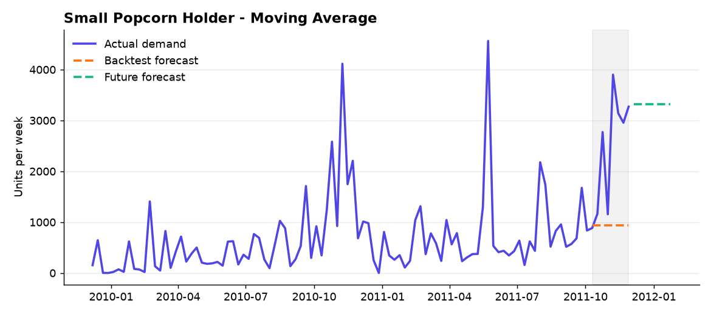
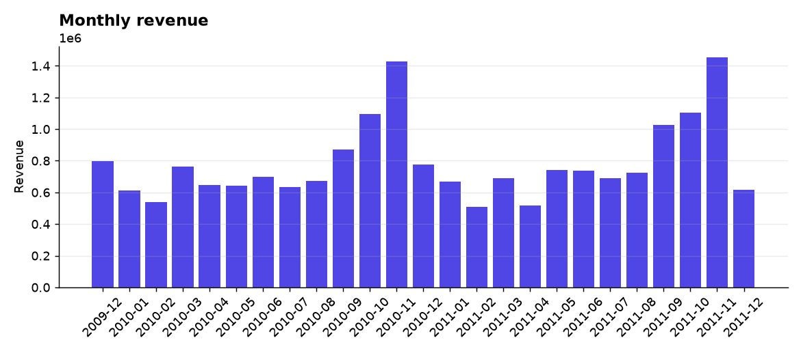
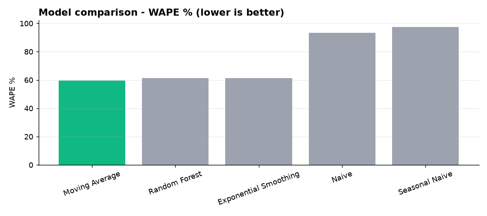

# 🛒 Smart Retail Demand Forecasting & Inventory Optimization

> Predict what customers will buy next, and know **exactly when to reorder**, with a simple, explainable pipeline and an interactive dashboard.



---

## 1. The Business Problem

A retailer with hundreds of products must answer two questions every week:

| If we stock… | Result |
|---|---|
| **too little** | customers leave, sales are lost |
| **too much** | cash is stuck in boxes, products expire or go out of fashion |

**This project forecasts weekly demand for the best-selling products and turns those forecasts into reorder points and safety-stock numbers a buyer can act on.**

**Who is it for?** Small and mid-size retailers, e-commerce shops, and anyone with sales history who wants better stock decisions without expensive software.

---

## 2. What You Get

| Deliverable | What it does | Where |
|---|---|---|
| **Data engineering** | Download, validate and clean transactions (with a "rows removed" report) | `src/download_data.py`, `src/cleaning.py` |
| **EDA** | Trends, seasonality, product and country analysis | `notebooks/01_retail_eda.ipynb` |
| **Forecasting** | 5 models compared: Naive, **Seasonal Naive**, Moving Average, Exponential Smoothing, Random Forest | `src/forecasting.py` |
| **Evaluation** | Time-based split (last 8 weeks hidden), **MAE, RMSE, WAPE** | `src/evaluation.py` |
| **Inventory planning** | Safety stock and reorder point per product | `src/inventory.py` |
| **Dashboard** | Interactive forecasts, model comparison, inventory alerts | `app/streamlit_app.py` |
| **Testing** | 26 automated checks on data quality and prediction behaviour | `tests/` |
| **Documentation** | This README: setup, business case, limitations | you are here |

---

## 3. Quick Start (about 5 minutes)

**You need:** Python 3.9 or newer ([download](https://www.python.org/downloads/)). On Windows, tick **"Add Python to PATH"** during install.

### Step 1: Open a terminal inside the project folder
- **Windows:** open the folder, click the address bar, type `cmd`, press Enter
- **Mac/Linux:** open Terminal and `cd` into the folder

### Step 2: Create a virtual environment (keeps your computer clean)
```bash
# Windows
python -m venv venv
venv\Scripts\activate

# Mac / Linux
python3 -m venv venv
source venv/bin/activate
```

### Step 3: Install the libraries
```bash
pip install -r requirements.txt
```

### Step 4: Run the whole pipeline (one command)
```bash
python run.py
```
This downloads the real dataset (first time only; the Excel file has ~1 million rows, so allow **3-6 minutes**; later runs take seconds), cleans it, trains and tests the models, builds the inventory plan and saves charts.

> 🌐 **No internet or download blocked?** Run `python run.py --synthetic` to use realistic generated demo data (the dashboard shows a warning banner so you never confuse it with real data).
> You can also download the dataset manually from the [UCI page](https://archive.ics.uci.edu/dataset/502/online+retail+ii), unzip it, open `online_retail_II.xlsx`, save both sheets as one CSV named `data/raw/online_retail_ii.csv`, then run `python run.py`.

### Step 5: Launch the dashboard
```bash
streamlit run app/streamlit_app.py
```
Your browser opens at `http://localhost:8501`.

### Step 6 (optional): Run the tests and notebooks
```bash
pytest                    # should print: 26 passed
jupyter notebook          # open the notebooks/ folder
```

### Common problems

| Problem | Fix |
|---|---|
| `python` not found | Try `python3`, or reinstall Python with "Add to PATH" ticked |
| `No results found yet` in dashboard | Run `python run.py` first |
| `ModuleNotFoundError` | Activate the virtual environment, then `pip install -r requirements.txt` |
| Download fails | Use `python run.py --synthetic` or the manual download above |
| Port already in use | `streamlit run app/streamlit_app.py --server.port 8502` |

---

## 4. How It Works (in plain English)

```
Raw transactions ─► Clean ─► Weekly demand per product ─► Forecast 5 ways ─► Pick best ─► Inventory plan ─► Dashboard
   (1.07M rows)   (remove    (fill empty weeks           (hide last 8      (lowest      (safety stock +
                    junk)      with zero)                  weeks, test)      WAPE)        reorder point)
```

1. **Cleaning.** Merges the file's two sheets, standardises column names, then removes cancellations, zero or negative quantities and prices, postage/bank-fee/test/gift-voucher rows, and duplicates (the two sheets overlap in December 2010). Every step is counted, so you can *show* the data quality work.
2. **Weekly demand.** Sales are grouped by week (Mon-Sun). Incomplete first/last weeks are dropped. Weeks with no sales become `0`.
3. **Forecasting.** Five models, simple on purpose:
   - *Naive*: next week = last week
   - ***Seasonal Naive* (the baseline to beat)**: same week last year (needs the 2 years of data)
   - *Moving Average*: average of the last 4 weeks
   - *Exponential Smoothing*: recent weeks matter more
   - *Random Forest*: ML that learns "last 4 weeks → next week"
4. **Evaluation.** The **last 8 weeks are hidden** from the models. They forecast them, and we compare to reality.
   - **WAPE** = total error ÷ total demand ("we are 25% off"), the headline number
   - **MAE** = average miss in units · **RMSE** = punishes big misses harder
5. **Inventory.**
   - `Safety stock = z × demand variability × √lead time` (z = 1.645 for a 95% service level)
   - `Reorder point = forecast weekly demand × lead time + safety stock`

Change any setting (lead time, service level, number of products…) in **`src/config.py`**.

---

## 5. Dashboard Tour

| Tab | What you see |
|---|---|
| 📊 **Business Overview** | Revenue, units, orders, monthly trend, top products, top countries |
| 🔮 **Forecast Explorer** | Pick a product and a model; actual vs backtest vs future forecast; download CSV |
| 🏆 **Model Comparison** | Ranked models, WAPE chart, how many products each model wins |
| 📦 **Inventory Planner** | Sliders for service level and lead time; type current stock → 🔴 Order now / 🟡 Watch / 🟢 OK |
| ℹ️ **About** | Method summary and limitations |

### Screenshots
After `streamlit run`, capture each tab and save into `reports/figures/` using these names, then they show up here automatically:

| | |
|---|---|
|  |  |
|  |  |

Charts generated automatically by `run.py`:




---

## 6. Results

> Fill this table with **your** numbers after running `python run.py` (see `reports/` or the *Model Comparison* tab).

| Model | MAE | RMSE | WAPE |
|---|---|---|---|
| (best model) | … | … | … |
| Seasonal Naive (baseline) | … | … | … |

**Key business takeaways to write for clients:** *(example structure)*
- Demand peaks in autumn, so stock must be built up in September-October.
- A small share of products drives most revenue, so focus forecasting effort there.
- Best model reduced forecast error by **X%** vs the baseline.
- Reorder points flag **N products** needing an order right now.

> 💡 **Honest note:** simple models often beat machine learning when there is little history (two years is still little). That is a *finding*, not a failure. Explaining *why* is what impresses clients.

---

## 7. Limitations (be upfront; clients trust honesty)

- **Only 2 years of history**: the models see just two yearly cycles, and the 8-week test window falls in the busy autumn season, so results may differ in a quiet season.
- Only the **top 20 products** are forecast, not the full catalogue.
- **No external signals** (prices, promotions, holidays, weather).
- Safety stock assumes demand variation is roughly bell-shaped and **lead time is fixed**.
- Sales ≠ true demand. If an item was out of stock, lost demand is invisible.
- The dataset is from a single UK-based online retailer (Dec 2009 - Dec 2011); results may not transfer to other businesses.
- The "Current stock" values in the dashboard are demo numbers; enter real ones.

## 8. Ideas to Extend (great for v2)

Add holiday flags and promotion features · forecast by country · prediction intervals · ABC product classification · Economic Order Quantity (EOQ) · deploy free on [Streamlit Community Cloud](https://streamlit.io/cloud).

---

## 9. Project Structure

```
Smart-Retail-Forecasting/
├── data/raw/            ← downloaded data (git-ignored)
├── data/processed/      ← cleaned data & result tables (git-ignored)
├── notebooks/           ← 01 EDA · 02 forecasting experiments
├── src/
│   ├── config.py        ← all settings
│   ├── download_data.py ← real download + synthetic fallback
│   ├── data_loader.py   ← read CSVs
│   ├── cleaning.py      ← clean + validate
│   ├── features.py      ← weekly demand, lag table
│   ├── forecasting.py   ← the 5 models
│   ├── evaluation.py    ← split, MAE/RMSE/WAPE, backtest
│   ├── inventory.py     ← safety stock & reorder point
│   └── plots.py         ← saves report charts
├── app/streamlit_app.py ← dashboard
├── models/               ← model_summary.json (best model & score)
├── reports/figures/     ← charts & screenshots
├── tests/               ← data-quality & behaviour tests
├── run.py               ← runs everything
├── requirements.txt
└── .gitignore
```

**Data:** [UCI Online Retail II dataset](https://archive.ics.uci.edu/dataset/502/online+retail+ii) (Chen, 2012), CC BY 4.0. DOI: 10.24432/C5CG6D
